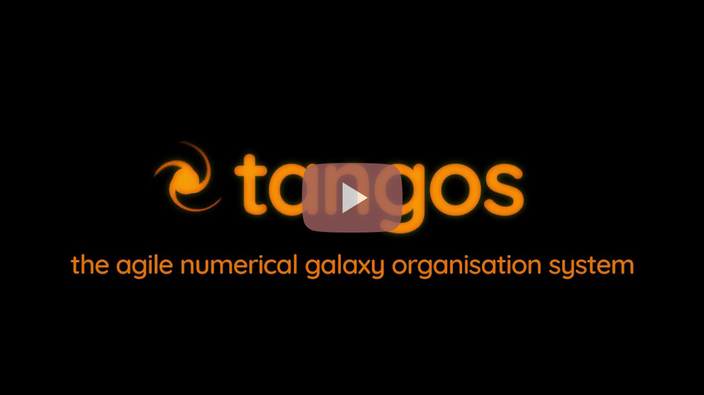

# tangos

tangos builds a database of *summary* data for your own cosmological and zoom
simulations -- masses, profiles, images, star formation histories, merger trees --
so that questions spanning an entire simulation are answered in milliseconds,
without touching the raw particle data again. It is the same idea as the public
[Eagle](http://icc.dur.ac.uk/Eagle/database.php) and
[MultiDark](https://www.cosmosim.org/cms/documentation/projects/multidark-bolshoi-project/)
databases, for your own runs.

You can then explore that database from python, or from a web browser:

[](https://www.youtube.com/watch?v=xHyzJmNsVMw)

## Start here

**New to tangos?** You do not need any simulation data to learn what tangos
does, and almost nothing here needs pynbody either -- only one call in the
quick-start, which says so where it appears. Install it, download the ready-made tutorial database,
and query it:

1. [Installation](installation.rst) -- tangos and the tutorial database, in
   three steps.
2. [Quick-start](tutorials/quickstart.rst) -- what a tangos database holds,
   then find a halo, read its properties, plot an image of a galaxy, and
   calculate with them.
3. [Time series and populations](tutorials/time_series.rst) -- follow a halo
   back through its progenitors and plot how it grew, and ask questions of a
   whole population at once.
4. [The web interface](tutorials/webserver.rst) -- the same database in a
   browser.

[The tangos data model](reference/data_model.rst) sets out the whole picture
-- simulations, timesteps, objects, properties and links -- when you want more
than the quick-start's summary.

When you need more from a calculation than those pages show -- interpolating a
profile, choosing between linked objects, a star formation history -- see the
[live calculation recipes](how-to/live_calculation_recipes.rst).

**Building a database from your own simulation** starts at
[making your first database](tutorials/first_database.rst), which walks through
one simulation from start to finish. The
[supported simulation formats](reference/simulation_formats.rst) table lists
every simulation code and halo finder tangos can read, and what changes for
each. You will need the raw simulation output and a reader for it, usually
pynbody. The tutorials then go further, in order:
[writing your own properties](tutorials/custom_properties.rst),
[histories between snapshots](tutorials/histograms.rst),
[black holes](tutorials/black_holes.rst),
[comparing simulations object by object](tutorials/crossmatching.rst) and
[tracking particles](tutorials/tracking.rst).

**At scale**, the how-to pages cover
[running in parallel](how-to/parallel.rst),
[large simulations](how-to/large_simulations.rst),
[managing a database](how-to/managing_a_database.rst) and
[MySQL or PostgreSQL](how-to/database_backends.rst).

**Configuring tangos** -- where the database lives, what gets written, how the
merger trees are thinned -- is covered in
[configuration](configuration.rst).

## Acknowledging the code

When using tangos, please acknowledge it by citing the release paper:
Pontzen & Tremmel, 2018, ApJS 237, 2.
[DOI 10.3847/1538-4365/aac832](https://doi.org/10.3847/1538-4365/aac832);
[arXiv:1803.00010](https://arxiv.org/pdf/1803.00010.pdf). Optionally you can
also cite the Zenodo DOI for the specific version of tangos that you are using,
which may be found [here](https://doi.org/10.5281/zenodo.1243070).

```{toctree}
:maxdepth: 2
:hidden:
:caption: Setup

installation
configuration
```

```{toctree}
:maxdepth: 2
:hidden:
:caption: Tutorials

tutorials/quickstart
tutorials/time_series
tutorials/webserver
tutorials/first_database
tutorials/custom_properties
tutorials/histograms
tutorials/black_holes
tutorials/crossmatching
tutorials/tracking
```

```{toctree}
:maxdepth: 2
:hidden:
:caption: How-to

how-to/live_calculation_recipes
how-to/parallel
how-to/managing_a_database
how-to/database_backends
how-to/large_simulations
how-to/custom_handlers
how-to/eagle
```

```{toctree}
:maxdepth: 2
:hidden:
:caption: Reference

reference/data_model
reference/simulation_formats
live_calculation
custom_properties
reference/api/index
```
